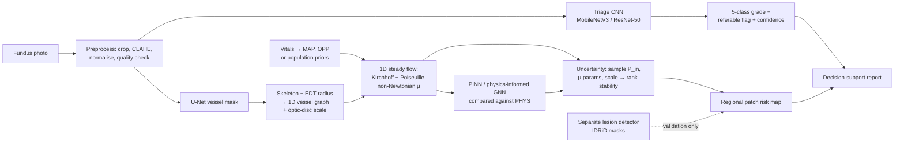

# Phase 1 — Plan

Inputs: *Diabetic Retinopathy AI Early Warning & Prevention System* (PDF, 16 pp.) and the master build prompt.
Status: **Milestones 1–11 built** (235 passing tests). M8 was built before M6–M7 because it needs no GPU or new data. Real-data results for M5–M9 come from the Colab runs, and M11 collects them into one summary. Updated 1 Nov 2026.

> Research prototype, not a medical device. All risk outputs are experimental and need independent clinical validation.

---

## 1. Architecture as specified in the PDF (§6.3, §8, §9)



Fixed design points taken from the PDF:
- Two tracks share only preprocessing; vitals enter only the physics model.
- The microaneurysm is **never** modelled as a 3D object; the visible arteriole/venule tree is a 1D graph, solved as a **steady-state** boundary-value problem.
- Output is a **relative, within-eye** ranking with confidence — never absolute stress thresholds or rupture timing.
- The classical solver is the **baseline and verifier**; the PINN must earn its place (§9.4).
- Lesion pixels are masked out of the geometry before validation runs (§9.3).
- Phasing (§11.6): Phase 1 = triage + graph + classical solver + proxy validation incl. physics-vs-geometry; Phase 2 = PINN/GNN, non-Newtonian, Bayesian UQ; Phase 3 = vitals, longitudinal, clinical validation.
- Research questions RQ1–RQ4 (§11.1); a null result (geometry is enough) is reported, not hidden.

## 2. Your seven uses → modules, data, and what is defensible

| # | Use (as written) | Modules | Data | What can honestly be delivered |
|---|---|---|---|---|
| 1 | Triage & referral prioritisation | preprocessing, quality, classification, calibration, report | APTOS 2019, IDRiD grading, +1 external set | **Buildable (M6).** Research triage ranking with calibrated confidence and an explanation per case. Not a clinical referral decision. |
| 2 | Follow-up in 1 month vs 6–12 | triage + regional risk + scenario view | Longitudinal fundus + outcomes — **none available** | **Not buildable as a recommendation.** Only a labelled research-scenario view. Any interval displayed must quote a published grading guideline keyed to DR grade, never a stress score. |
| 3 | Focal laser: “exact leaking microaneurysms” | separate lesion segmentation + coordinates overlay | IDRiD pixel lesion masks | Lesion **localisation overlay** for clinician review. Leakage is a fluorescein-angiography finding; a colour photo plus a stress model cannot identify leaking lesions or treatment targets. |
| 4 | “Virtual angiogram” showing leakage without dye | vessel seg, graph, solver, overlay | DRIVE (+ IDRiD images) | A **model-derived vascular stress map**. It shows estimated stress under assumptions; it shows no leakage, perfusion or dye-equivalent information. |
| 5 | Pre-lesion map: WSS at sharp/twisted bends before lesions form | graph features, solver, patch aggregation, Exp 5 | IDRiD lesion masks (cross-sectional) | **Cross-sectional association only** (“current vulnerability map”). Two corrections: the 1D Poiseuille model has **no curvature term**, so bends enter only as a tortuosity feature; “before it forms” needs longitudinal data (PDF §11.5). |
| 6 | Stress test: BP or HbA1c spike | solver + UQ + simulator | priors only | **BP: proved in M1 that in the Newtonian model a BP change multiplies every segment’s WSS by the same factor — the ranking cannot change.** Only nonlinear rheology or autoregulation could reorder it, and autoregulation is not modelled. **HbA1c: no established quantitative link to model parameters → excluded** until a source is found. |
| 7 | Instant CFD replacement | benchmark (Exp 7), PINN vs classical | none | The classical 1D solver already runs in **~2 ms for ~520 segments** (measured, §6). It is a reduced-order model, not 3D CFD, so “hours vs milliseconds” is not a like-for-like claim. A standard PINN is trained per problem and will be **slower**, not faster (see A11). |

## 3. Assumptions that are not yet supported — and how each gets tested

| # | Assumption | Problem | Test / handling | When |
|---|---|---|---|---|
| A1 | Rank stability across BP, viscosity, image scale (RQ3, §7.3) is evidence | **Mathematically guaranteed** in the Newtonian two-pressure model (proved, `tests/test_invariance.py`). Monte Carlo over those four parameters gives 100 % stability by construction. | UQ must sample what actually reorders rankings: heterogeneous outlet BCs, per-segment radius error, additive segmentation bias, diameter-dependent viscosity (Fåhræus–Lindqvist), shear-thinning, topology errors. **M2:** confirmed numerically (controls: rank correlation 1.000, §6). | M2 ✅, M7 |
| A2 | All visible endpoints sit at one outlet pressure (≈ IOP, §9.4) | Ignores downstream capillary resistance and endpoints that are only image-border or visibility cut-offs. Flow distribution is dominated by this choice. | Compare Dirichlet vs terminal-resistance (Robin) BCs, flag border-truncated endpoints, report rank agreement. **M2: the largest single effect — about half of the top-10 % segments change with the outlet assumption.** Must be sampled in M7 and stated in every report. | M2 ✅, M3, M7 |
| A3 | One vessel graph per eye | Arteries and veins **cross**; a skeleton turns crossings into false junctions joining the arterial and venous trees, short-circuiting the flow model. | Crossing detection + artery/vein labelling (A/V-labelled sets, to verify); separate arterial and venous solves. **M3:** clean crossings (25–90°) are split correctly; crossings at branch points are only flagged — on synthetic fundus-like images 2 of 9 true crossings were split. Rule-based resolution is not enough → **artery/vein segmentation added to M5**; no physics on graphs whose arteries and veins are still joined. **M5:** multi-label U-Net (artery and vein as separate outputs, so crossings stay in both trees); on synthetic ground truth, separate graphs cut crossing flags 38 → 5 and gave one piece per tree. Real-data check in the Colab run. | M3 ✅, M5 ✅ |
| A4 | Bends/tortuosity raise WSS | No curvature term in 1D Poiseuille; at retinal Reynolds numbers (≈ O(1)) secondary flow is negligible. | Tortuosity stays a **geometry feature** in the baseline, not a physics output. | M2 |
| A5 | EDT radius is accurate enough | Arterioles are a few to ~15 px wide; at fixed flow τ ∝ r⁻³, so 1 px error is large. Blur and resolution bias widths. | Synthetic tubes of known radius; ±1 px sensitivity analysis; additive-bias UQ (A1). **M2:** 10 % per-segment radius error keeps only ~63 % of the top-10 % set, 5 % keeps ~81 % → target ≤ 5 %. **M3: the EDT method (as in the PDF) fails it — 20–50 % error at 1–2 px radius, ~10 % mid-range. Area-based width meets it: ≤ 3 % (binary mask), ≤ 0.4 % (soft mask) on synthetic tubes.** Real-mask noise still to be measured (M5). | M2 ✅, M3 ✅, M5, M7 |
| A6 | High WSS marks vulnerable segments | Literature also links **low/disturbed** shear to damage. The M1 demo already shows a narrowing creates high shear in the segment and low shear downstream. | Score both directions in Exp 5, pre-registered. | M7 |
| A7 | Stress on feeding vessels relates to capillary lesions | Microaneurysms sit on capillaries the photo cannot resolve (§10). | Patch-level association only; no per-lesion claims. | M7 |
| A8 | Optic disc gives physical scale | Physical disc size is assumed, varies between people. In the Newtonian model scale cancels from rankings (A1); it matters only once viscosity depends on absolute diameter. | Treat disc diameter as an uncertain prior; report scale-free outputs when no disc is found. | M2, M3 |
| A9 | Non-Newtonian laws apply | Casson/Carreau parameters come from bulk rheometry; Fåhræus–Lindqvist fits are in-vitro tube data. Applicability at 20–150 µm is uncertain. | Use only with cited parameters; ablation with/without (Exp 4). **M2:** shear-thinning is negligible at arteriolar shear rates (top-10 % overlap 1.00); Fåhræus–Lindqvist is modest (0.84) → keep FL as an ablation, drop Carreau–Yasuda from the main model. | M2 ✅ |
| A10 | Steady state, no autoregulation | One photo has no time; the retina autoregulates. | Label outputs “baseline stress under assumed perfusion” (§11.4). | all |
| A11 | A PINN adds value | Forward problem is a sparse linear solve (ms). A standard PINN trains **per network** (minutes); only a GNN trained across many graphs could amortise cost. Possible real value: inverse problems (learning uncertain parameters). | Exp 3/7: accuracy, conservation error (`evaluate_pressure_field`), training + inference cost vs classical. Report a negative result if so. **Title risk:** decide framing after M8. **M8 (synthetic networks):** direct solve exact in ~2 ms; per-network PINNs 1–10 s and approximate; classic coordinate PINN degrades on larger networks; PI-GNN 8× more accurate than CG at equal steps but worse than the direct solve. → PINN adds no value for the forward problem; title framing to discuss with supervisor. | M8 ✅ |
| A12 | DRIVE-trained U-Net transfers to IDRiD/APTOS | DRIVE: 40 images, field of view ≈ 540 px across, **expert masks public for the 20 training images only** (test masks withheld); IDRiD/APTOS: different cameras, much higher resolution; IDRiD has **no vessel ground truth** to check. | Add a high-resolution vessel set (e.g. HRF — verify), visual audit on IDRiD. | M4, M5 |
| A13 | Patch-level statistics are independent | Patches within one eye are correlated; the IDRiD lesion set is small (81 images, confirmed in M4; haemorrhage masks for 80, soft exudates for 40). | Image-level bootstrap CIs and permutation tests; never patch-level i.i.d. CIs. | M7 |
| A14 | APTOS splits are clean | No patient IDs; only `train.csv` carries grades. Duplicates not confirmed by a reliable source. | **M4:** near-duplicate grouping across all datasets (calibrated: different eyes ≤ 0.76, copies ≥ 0.987, threshold 0.92); group-level splits; leakage check. Patient-level splitting impossible — stated as a limitation. Duplicates on the real data are reported by the Colab run. | M4 ✅ |
| A15 | “Referable DR” is well defined | Datasets differ (APTOS has no DME label). | Define referable = ICDR grade ≥ 2 (moderate or worse); state DME exclusion. **M4:** encoded in the manifest (`referable` column) and `datasets/records.py`. | M4 ✅, M6 |
| A16 | Population BP priors stand in for the patient | No paired vitals in public data (§9.1). | Outputs are eye-level, not person-level pressure claims; Phase 3 needs a clinical cohort. | all |

## 4. Repository structure

```
dr-pinn/
  README.md  pyproject.toml  requirements.txt
  configs/            physics priors (with sources), data, training, experiments  [M2+]
  data/               git-ignored; data/README.md = local setup guide             [M4]
  checkpoints/        git-ignored weights + model_card.json (source, licence, domain) [M5+]
  docs/               PLAN.md, hemodynamics_solver.md, datasets, API, paper outline
  scripts/            benchmark_solver.py, demo_synthetic.py, train_*, evaluate_*, run_pipeline
  src/drpinn/
    hemodynamics/     ✅ units, network, solver, synthetic  · M2 rheology, terminal BCs
    vessel_graph/     mask → skeleton → graph, EDT radius, features, A/V, crossings, scale
    preprocessing/    crop, CLAHE, normalisation, quality check
    classification/   MobileNetV3 / ResNet-50 triage, calibration
    segmentation/     U-Net vessels
    lesions/          separate lesion detector — never feeds the physics model
    pinn/             PINN / physics-informed GNN + comparison harness
    uncertainty/      Monte Carlo, rank stability (tie-aware), sensitivity
    regional/         patch aggregation, risk maps
    evaluation/       metrics, bootstrap, permutation tests, experiment runners
    api/              FastAPI backend
    reporting/        exportable research report
  tests/
  frontend/           Next.js + TypeScript dashboard
  reports/            benchmarks/, experiments/, figures/
```
Deviations from the prompt’s layout, with reasons: a named package `drpinn` (generic top-level names like `preprocessing` collide on import); `lesions/` split from `segmentation/` to enforce the lesion/stress separation; `regional/` and `reporting/` added because both are distinct outputs.

## 5. Roadmap

Order follows the PDF’s phasing: the core thesis result (classical solver + proxy validation) comes **before** the PINN and the dashboard.

| M | Deliverable | Exit criteria | Data |
|---|---|---|---|
| **1 ✅** | Units, vessel network, classical solver (Dirichlet / Neumann / Robin), synthetic networks, violation metrics, benchmark | 66 tests incl. analytical, conservation, invariance, mutation-checked | none |
| **2 ✅** | Rheology (Fåhræus–Lindqvist, shear-thinning with convergence diagnostics), Murray terminal-resistance BCs, geometry-only features, tie-aware ranking, rank-sensitivity study | Formulas checked against sources; 98 tests; reproducible study (§6) | none |
| **3 ✅** | Vessel-graph extraction: skeleton, junctions/segments, area-based sub-pixel width, spur pruning, crossing split + flags, border flags, DRIVE loader, centreline comparison metrics | 132 tests; synthetic recall/precision ≥ 0.97, radius error ≤ 2 %; runs on DRIVE expert masks in Colab | DRIVE |
| **4 ✅** | Verified facts for DRIVE, RITE, IDRiD, APTOS, Messidor-2; loaders; integrity + cross-dataset duplicate grouping; group-stratified splits + leakage check; APTOS working copy; synthetic-data mode | 151 tests; `docs/datasets.md`, `data/README.md`; manifest + integrity report produced in Colab | public |
| **5 ✅** | Multi-label U-Net (vessel, artery, vein) keeping the probability map; tiled prediction; 5-fold CV with fixed per-photo folds; final model; RITE test set; centreline + radius agreement; artery/vein graphs; resumable training | 167 tests (16 for M5, mutation-checked); real results from the Colab T4 run | DRIVE, RITE |
| **6 ✅** | Quality check + MobileNetV3 triage (Exp 1): temperature scaling, validation-fixed referral threshold (≥ 90 % sensitivity), entropy uncertainty, Grad-CAM, triage card | Pre-registered (`docs/m6_triage.md`): referable AUC on IDRiD external test, QWK on APTOS internal test, bootstrap CIs; 18 tests incl. null/positive synthetic controls, mutation-checked | APTOS, IDRiD |
| **7 ✅** | **Core thesis:** Monte Carlo UQ on artery/vein graphs, patch risk, physics vs geometry and position baselines, lesion association | Pre-registered (`docs/m7_analysis_plan.md`): within-image AUROC on 27 IDRiD test images, t-intervals over images (bootstrap shown anti-conservative), paired baselines; 16 tests incl. null/positive controls, mutation-checked | IDRiD lesions |
| **8 ✅** | Physics residual (exact zero at the solver solution), nodal + coordinate PINNs, physics-informed GNN (untrained = Jacobi), Jacobi/CG same-budget baselines, comparison on synthetic + DRIVE graphs | 180 tests (13 for M8, mutation-checked); results table in `docs/pinn.md` | synthetic + DRIVE |
| **9 ✅** | FastAPI backend: quality, triage card + Grad-CAM, vessels/A-V graphs, Monte Carlo shear map, optic-disc estimate (or user click) | 13 API tests incl. missing-model, corrupt/oversized/invalid uploads; disc check on IDRiD (`scripts/m9_check_disc.py`); `docs/api.md` | models from M5–M6 |
| **10 ✅** | Dashboard (10 sections), one HTML page served by the backend (Next.js dropped: no Node build in Colab; reason in `docs/api.md`) | Bound to the real `/api/analyse` response, disclaimers everywhere; checked in a browser (light, dark, phone width) | — |
| **11 ✅** | Results collector, thesis outline, consolidated limitations | `scripts/m11_collect_results.py` → `reports/summary/results_summary.{json,md}` with provenance and validity warnings; `docs/thesis_outline.md` | all reports |

Buildable **without clinical data**: M1–M3, M8 (synthetic and DRIVE graphs), M9–M10 shells. Needs **public datasets**: M4–M7. Needs a **clinical collaboration** (Phase 3): paired vitals, longitudinal follow-up (uses 2 and the “future” in use 5), external clinical validation.

Dependencies by milestone: M1 numpy, scipy, pytest · M2–M3 networkx, scikit-image, opencv-python, matplotlib · M5–M8 torch, torchvision (GPU strongly recommended: free Kaggle/Colab tiers) · M9–M10 fastapi, uvicorn, python-multipart (httpx for tests); the dashboard needs no extra tools.

## 6. Results so far

### M1 — solver latency (Claude sandbox: Linux, 2 vCPU, Python 3.13 — re-run on your machine)

| Segments | 16 | 129 | 521 | 2,087 | 8,354 | 16,710 |
|---|---|---|---|---|---|---|
| Median solve (ms) | 1.2 | 1.4 | 1.9 | 3.4 | 9.9 | 19.2 |

Monte Carlo: 1,000 samples × 521 segments with per-segment radius noise = 2.2 s. Raw data: `reports/benchmarks/solver_latency.json`.

### M2 — what reorders the WSS ranking (SYNTHETIC: 20 random trees × ~255 segments, 20 samples each; illustrative perturbation sizes)

| Perturbation | Spearman | Top-10 % kept (mean / worst 5 %) |
|---|---|---|
| Controls: blood pressure, viscosity, image scale, uniform ×radius | 1.000 | 1.00 / 1.00 |
| Outlet pressures differ (10–20 mmHg each) | 0.58 | 0.45 / 0.31 |
| Terminal resistance (2–10 unseen Murray levels) | 0.85 | 0.47 / 0.31 |
| Radius error 5 % / 10 % / 20 % per segment | 0.95 / 0.84 / 0.61 | 0.81 / 0.63 / 0.42 |
| Additive radius bias ±3 µm | 0.98 | 0.87 / 0.73 |
| Length error 10 % | 0.98 | 0.88 / 0.77 |
| Fåhræus–Lindqvist (Hd 0.45; or Hd 0.30–0.50 with scale ×0.8–1.2) | 0.98 | 0.84–0.85 / 0.77 |
| Shear-thinning (Carreau–Yasuda) | 1.000 | 1.00 / 0.96 |

Consequences: (1) outlet boundary conditions and radius accuracy dominate, so M7 must sample both and reports must state the outlet assumption; (2) M3 needs sub-pixel width estimation; (3) shear-thinning is dropped from the main model with this evidence, Fåhræus–Lindqvist stays as an ablation; (4) the PDF's §7.3 point 1 ("geometry sets where stress concentrates") holds only once the outlet conditions are fixed — this belongs in the limitations. Raw data: `reports/experiments/m2_rank_sensitivity.json`.

### M3 — vessel graph from a mask (SYNTHETIC masks of known geometry)

| Check | Result |
|---|---|
| Straight tubes (0–70°), curved tube | 1 segment each; length within 2 %, tortuosity within 2 % |
| Radius, distance transform (PDF method) | 50 % / 19 % / ~10 % median error at 1 / 2 / 4–8 px radius |
| Radius, area method — binary / soft mask | ≤ 3 % / ≤ 0.4 % at all radii 1–8 px (810 tubes, 0 topology failures) |
| Fundus-like two-tree images (8) | centreline recall ≥ 0.977, precision ≥ 0.986; radius median error 1.3 % (binary), 0.6 % (soft) |
| Crossings | clean X crossings 25–90° split correctly; 4-arm junctions that are not straight-through kept; at branch points only 2 of 9 split, most others flagged |

Consequences: keep the U-Net probability map for width (M5); separate arteries and veins before any physics on real graphs (M5). Raw data: `reports/experiments/m3_width_accuracy.json`; DRIVE results are produced in Colab (`reports/m3_drive/`).

### M4 — data checks (verified on SYNTHETIC dataset folders with planted problems; real numbers come from the Colab run)

| Check | Result |
|---|---|
| Duplicate signature calibration | different eyes ≤ 0.76; copies rescaled ×0.7–×4, brightened, JPEG q75–92 ≥ 0.987; threshold 0.92 |
| Planted problems found | corrupt PNG, label without image, image without label, conflicting-grade duplicate (excluded), IDRiD grading↔segmentation duplicate (moved to test), DRIVE↔RITE shared photos (same fold) |
| Split proportions (APTOS-sized, 3,662) | 70 / 15 / 15 within ±0.3 % in every grade |
| Leakage check | passes; a planted violation is caught |

Bugs found and fixed while building M4: JPEG fast-decode shrank images below the signature size (duplicates missed), the field-of-view outline made different eyes look alike, the signature cache failed on re-read.

### M5 — segmentation (verified on SYNTHETIC data; real numbers come from the Colab GPU run)

| Check | Result |
|---|---|
| A/V graph separation (true masks, 12 synthetic images) | crossing flags 38 → 0 (artery) + 5 (vein); every tree one piece (combined graph fused the trees in 7/12) |
| Over-width diagnosis (tiny model) | 300 steps: radius +49 %; 1,500 steps: 1.5–1.8 % for every sampling setting → cause was under-training |
| Tiny end-to-end CPU run | Dice > 0.75, AUC > 0.97, A/V accuracy > 0.9, centreline recall > 0.9 |
| Training cost (full preset) | 7.8 M parameters, 163 GFLOP per step; estimated 1–4 min per model on a T4 (6 models) |

Change made while building M5: DRIVE/RITE cross-validation folds are now fixed per photo number (`drive_fold`), so adding RITE no longer reshuffles DRIVE folds and the manifest and M5 always agree.

### M8 — PINN vs classical solver (20 SYNTHETIC test networks; DRIVE graphs added in the Colab run)

| Method | Median / worst pressure error | WSS top-10 % kept | Median time |
|---|---|---|---|
| Direct solve | 0 / 0 | 1.00 | 2.2 ms |
| Jacobi(30) | 1.8e-1 / 4.8e-1 | 0.71 | 0.8 ms |
| CG(30) | 4.2e-2 / 2.6e-1 | 0.96 | 1.7 ms |
| PI-GNN(30) | 5.4e-3 / 3.5e-1 | 1.00 | 14.5 ms (+90 s training once) |
| Nodal PINN | 1.2e-5 / 6.8e-3 | 1.00 | 2.2 s |
| Coordinate PINN | 8.3e-3 / 1.3e-1 | 1.00 | 10.1 s |

Details and interpretation: `docs/pinn.md`.

## 7. Checklist

- [x] Read PDF and prompt; architecture, use-case map, assumptions, structure, roadmap
- [x] M1 units + vitals helpers (labelled as assumptions)
- [x] M1 vessel network container with unit-mistake guards
- [x] M1 classical solver: Dirichlet, Neumann, Robin; WSS, ΔP, velocity, shear rate
- [x] M1 violation metrics for any pressure field (conservation, Dirichlet error) — reused for PINN scoring
- [x] M1 tests: analytical (pipe, series, parallel, Y-junction, Murray tree, Robin, Neumann), conservation vs independent code and dense solver, invariance proofs, validation, mutation-checked
- [x] M1 latency benchmark + synthetic stenosis demo
- [x] M2 Pries 1992 Fåhræus–Lindqvist + Carreau–Yasuda viscosity, damped nonlinear solve with convergence reporting
- [x] M2 Murray terminal-resistance BCs (exactly reproduce a truncated tree)
- [x] M2 geometry-only features (RQ1 baseline), tie-aware ranking utilities
- [x] M2 rank-sensitivity study (reproducible) + Colab notebook with version-checked upgrades
- [x] M3 mask → vessel graph (skeleton, junction clusters, spur pruning, crossing split/flags, border flags, self-loop splitting)
- [x] M3 area-based sub-pixel width + synthetic width-accuracy study
- [x] M3 synthetic mask renderer, centreline comparison metrics, DRIVE loader and graph script, Colab section
- [x] M4 verified dataset facts, licences and citations (`docs/datasets.md`)
- [x] M4 loaders: IDRiD (grading, lesion masks, disc/fovea), APTOS, RITE (A/V colour decoding), DRIVE
- [x] M4 integrity check, calibrated near-duplicate grouping, group-stratified splits, leakage check, manifest fingerprint
- [x] M4 APTOS working copy (resumable, parallel) + Kaggle download cell; synthetic-data mode
- [x] M5 multi-label U-Net, preprocessing, tiled prediction, resumable training (checkpoints in Drive)
- [x] M5 CV + final model + RITE test; pixel, centreline, radius and A/V metrics; artery/vein graph separation
- [x] M5 stable DRIVE/RITE folds (fixed per photo); synthetic A/V data; Colab GPU section
- [ ] M5 run on real DRIVE/RITE in Colab and record results
- [x] M8 physics residual, nodal/coordinate PINNs, physics-informed GNN, same-budget Jacobi/CG baselines, comparison script + figure
- [ ] M8 run with real DRIVE graphs in Colab (CPU)
- [x] M7 Monte Carlo shear risk, patch table, image-clustered stats, pre-registered plan, null/positive controls
- [ ] M7 run on real IDRiD in Colab (after M5 `full`)
- [x] M6 quality check, MobileNetV3 triage, calibration, threshold, uncertainty, Grad-CAM, triage card, controls
- [ ] M6 run on APTOS + IDRiD in Colab (GPU)
- [x] M9 API, optic-disc estimate + IDRiD check script · [x] M10 dashboard · [x] M11 results collector + thesis outline
- [ ] Run M9 disc check and M11 summary in Colab after the M5–M8 runs (steps 16–17)
